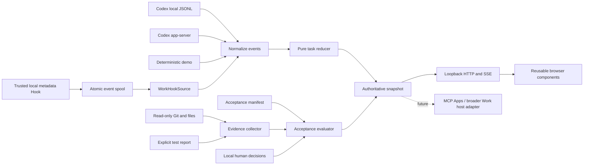

# Architecture / 架构

## Responsibilities

The collector owns parsing and transport. The reducer owns only task state. The acceptance evaluator receives **no tool count or model-generated percentage**. The service joins task state and evidence, serializes source changes/reviews/refreshes, and publishes complete snapshots. The browser renders those snapshots and submits explicit human decisions.

采集层负责接入与规范化，任务状态引擎负责回合/计划/工具，验收引擎只接收条件与证据。本地服务统一串行处理来源切换、刷新和验收保存，避免不同来源的数据交叉。UI 不自行提高完成度。

## Core contracts

Normalized events have `id`, `kind`, optional `at`, `source`, and kind-specific fields. Kinds: task, turn, phase, plan, tool, usage, message, warning, hook. Unsupported records, private reasoning and system/developer content are ignored. Hook events retain the four base metadata fields, optional authorized tool_name/tool_status, and receiver timing; observed Stop is not mapped to task completion.

`reduceEvent(state,event)` returns a new bounded state. A new turn clears plan/tools and the last-request metric. Duplicate retained event IDs are ignored. Only 160 events and 40 tools are retained. Source gaps clear unprovable state; they do not carry an old completed status forward.

`evaluateAcceptance(manifest,evidence,reviews)` returns criteria, distinct counts, accepted/total weight, and nullable coverage. All declared files must be present before named passing checks can verify the criterion. A current failed check or human rejection dominates. Human approvals are valid only when both the evidence fingerprint and manifest hash match.

`SnapshotHost` in `src/adapters/contract.d.ts` is a future transport boundary. It is a contract reservation, not an implemented Work/MCP integration.

## Collection and scope

- Local logs: filename/stat-only discovery with canonical UUIDs and separate explicit Codex content grants; bounded discovery under one Codex data root; complete newline records only; UTF-8 chunk boundaries preserved; malformed records skipped with diagnostics. Poll and rediscover every two seconds while selected. Snapshots include the current session list; new arrivals never steal an explicit selection.
- App-server: literal loopback endpoint, initialize handshake, authorized thread/read only. Global thread/list and unsolicited notifications are disabled; replies require a leading correlated numeric ID before payload parsing. Current-turn history only. No auto-resume or approval response.
- Local Hooks: bounded nonrecursive metadata spool, independent from Codex logs. Discover session IDs without stealing selection. Product origin is unknown until explicitly labeled; Hook mode never inherits a workspace or acceptance evidence. [Detailed contract and limits](WORK-HOOKS.md).
- Git: selected workspace must be the repository root. No optional index locks, textconv or external diff helpers. Only sanitized indexed paths enter the diff; sensitive paths are omitted before the command is constructed. Untracked files can be inspected as bounded text, but are not represented as tracked Git diffs.
- Evidence files: realpath confinement, traversal/sensitive-path rejection, 2 MiB limit. No arbitrary file-read API; detail IDs must already exist in the evidence index.

## State and persistence

Human decisions are written atomically into `.aps-data/reviews.json`, keyed by source type, session, workspace and task ID. Accept/reject/clear actions require same-origin access and a per-process token. The service refreshes evidence before committing a review and rejects stale dialog fingerprints. Export is a local download, not an upload.

Only UI language/theme are saved in localStorage; selected navigation uses sessionStorage. Hook product labels and separate log/RPC body grants persist in `.aps-data/session-access.json`; legacy `hook-origins.json` labels migrate with no body grant; they are user assertions, not host-provided identity. No Codex credentials, settings or original logs are written by the dashboard. The current source choice is intentionally not persisted across server restarts; CLI flags choose the initial adapter.

人工验收存于本工具目录，不写入 Codex 或用户仓库。关闭/重新启动不会丢失决定；修改源码、测试报告或验收定义会使旧决定失效。来源选择重启后重新发现，防止误连历史任务。

## Local security model

Bind to `127.0.0.1`; reject mismatched Host/Origin and cross-site fetch metadata; mutation requests require JSON and the process token. Serve only a fixed asset list. CSP allows only local application resources and forbids embedding this standalone page. This protects against ordinary cross-origin web access; it is not an authentication boundary against software already running under the same local user.

No outbound runtime analytics or assets. Basic API-key/Bearer redaction is defense in depth, not a universal secret detector. User code and task excerpts can be present locally and in explicitly exported reports. Known sensitive paths are excluded. No commands from manifests, logs or reports are executed.

## Limits and tradeoffs

2-second polling favors portability over native file watchers. Fingerprinting intentionally errs toward unknown when limits or symlinks prevent a complete snapshot. A report attests a local producer's result for file contents; it is not a cryptographic proof of test honesty, coverage quality, dependency/runtime equivalence or resistance to deliberate tampering. Review substantial changes with the underlying files and tests.

Runtime dependencies: none. Optional Playwright development dependency supplies real-browser verification. ES-module components avoid a build chain and can be bundled into a future MCP UI resource without coupling the core to a host SDK.

## Monitor interpretation

`monitorTask` derives last observed activity and its evidence time. A 30-second threshold downgrades nonterminal running evidence to unknown, never to failure or disconnected. `Stop`/completed-turn labels describe the last turn only. Hook callbacks are not paired: tool call IDs are outside the authorized collection scope, and asynchronous starts/returns may be delivered out of order. Missing structured outcome stays unknown.

`progressSummary` keeps overall completion nullable and independent of agent-reported plan fractions and weighted acceptance. The homepage presents source/session selection, activity, three distinct measures, tools/events, then supporting evidence. No heartbeat or remaining-work estimate is invented.

The browser also expires cached nonterminal observations with its own clock, so a stalled SSE feed cannot leave an old running label indefinitely. An SSE error replaces the main activity label with disconnected/current-activity-unknown. Demo review phases and timestamp-free app-server terminal history remain explicit; history without a completion timestamp does not acquire one.

All log and RPC content gates, UUID normalization, cached-state clearing and evidence-path protection are defined in [PRIVACY-SCOPE](PRIVACY-SCOPE.md). Discovery never reads even the first line. Unknown product identity defaults to denied; custom filenames are unsupported. The header check only validates an already-authorized ID before the body reader can run. Source labels alone do not grant access. Four/six-field Hook records and their field sources are documented in [WORK-HOOKS](WORK-HOOKS.md); the recorder is unchanged by RC3.
